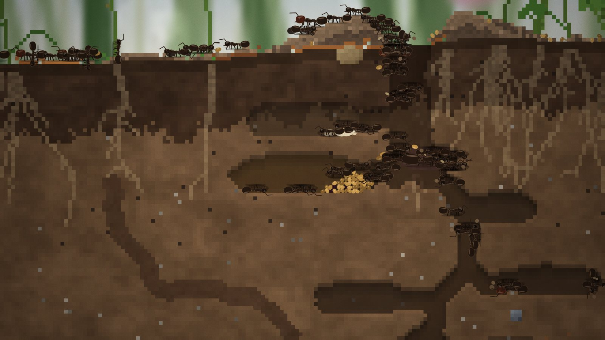
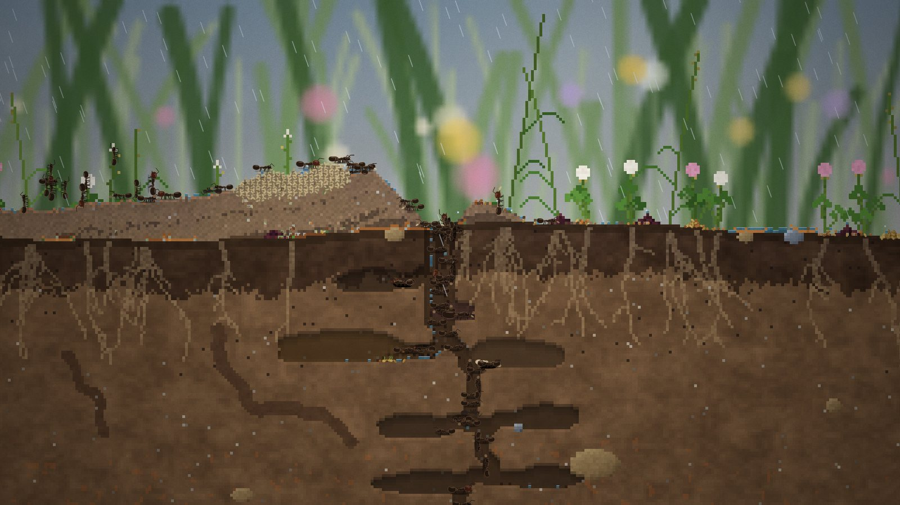

# Underfoot

*Çalışma adı.* Gerçek ölçekte (1 piksel = 1 mm) bir toprak kesitinde *Messor structor* hasatçı karınca kolonisi simülasyonu. Oyuncu karıncalara emir vermez, koloninin önceliklerini belirler.

Tasarım belgesi, görsel dil kararları ve açık sorular: [docs/GDD.md](docs/GDD.md)

Görsel inceleme (beş kişilik sanat paneli) ve yakın plan için makro lens, önce/sonra görüntülerle: [docs/art-review/](docs/art-review/README.md)

Oynanabilir sürüm (özel link): https://claude.ai/artifact/Ja2FVX7Gs5UHxjRM7yPXha


| | |
|---|---|
|  |  |
|  |  |

## Çalıştırma

```bash
npm install
npm run dev            # http://localhost:5173
```

- `?seed=123` aynı haritayı yeniden üretir.
- `?site=anatolia` sahayı seçer: `pannonian`, `sand`, `limestone`, `vineyard`, `anatolia`, `pontic`.
- `?paused=1` duraklatılmış başlatır.

## Dünya

Altı gerçek *Messor* sahası (Pannonya lösü, kumlu bozkır, kireçtaşı tepe, bağ kenarı, Orta Anadolu, Karadeniz bozkırı), her biri kendi iklimi, toprak profili ve bitkileriyle. Aynı sahanın her haritası farklı: toprak kalınlığı, katmanların dalgası ve eğimi, bakı, tohum bankası, kil, kum ve çakıl mercekleri, yassı taşlar, eski yuvalar, çürümüş köklerin bıraktığı kanallar, keşfedilmeyi bekleyen gizli oyuklar, mevsimine göre tohum yağdıran bir ağaç (Mayıs'ta karaağaç diskleri, sonbaharda dönerek inen akçaağaç kanatları; gövdesi gölgeli bir sütun ve öğleden sonra çayıra gölge düşürüyor, alçak dalları arka planda odak dışı ve mevsimle renk değiştiriyor; kabuğunda yaprak bitlerine giden bir siyah bahçe karıncası izi, dibinde güneşlenen kırmızı-siyah böcekler ve zıplayan bir örümcek var), çalı, mevsimle yükselip çekilen taban suyu, çömlek kırıkları, ağustos böceği perileri ve mayıs böceği kurtçukları. Toprak da yaşıyor: kökler mevsimde uzayıp kazının yoluna giriyor (kesilmeleri gerekiyor), sonbaharda çürüyüp kanala dönüyor; solucanlar arkalarında ince tüneller bırakıyor. Kuru hafriyatı rüzgâr savuruyor, yağmur bastırıyor; höyük bu yüzden alçak kalıyor. Takvim haftalık: kış uykusu, kar, yılda bir evlilik uçuşu. Yüzeyde beş bitki türü tohum takvimine göre olgunlaşıp kuruyor; karaçalı ya da kuşburnu çiçek açıp meyve döküyor, ağaç gölge yapıp yaprak döküyor; çekirge, Harpalus böceği ve solucanlar dolaşıyor. Tehditler gerçek kayıtlardan: *Zodarion* örümceği, forid sinek ve karıncanın "C" duruşu, mantar ve sosyal bağışıklık, karınca aslanı çukurları, yuva misafirleri. Toprağın altından da gelenler var: kreşe kıl inceliğinde galeri kazıp yumurta çalan hırsız karıncalar (*Solenopsis fugax*), geceleri tünellere sızan kırkayak (*Lithobius*) ve nemli lösü delip odalara dalan danaburnu (*Gryllotalpa*); alarmı alan işçiler üstlerine koşuyor, gedikleri toprakla kapatıyor. Koloniyi gerçekten bitirebilecek büyük hayvanlar da var: alacakaranlıkta kapının yanına oturup toplayıcıları diliyle tek tek yutan ve yuvayı bulunca gece gece geri gelen yeşil kurbağa (*Bufotes viridis*), sıcakta höyükte güneşlenip geçen toplayıcılara atılan kum kertenkelesi (*Lacerta agilis*) ve nadiren kesiti baştan sona geçen köstebek (*Talpa europaea*): tüneli arkasında kapanıyor, yuvadan geçerse odaları gevşek toprakla dolduruyor, yavruları yiyor ve kraliçeyi öldürebiliyor. Yuva da kusursuz bir plan değil: kraliçe ilk kuyunun toprağını ağzında yukarı taşıyor; galeriler kazıcıların bıraktığı koku sürdükçe kendiliğinden uzuyor, kalabalık odalar karıncaların toplandığı yana doğru genişliyor; odalar loblu ve yamuk, doldukça yanına lob ekleniyor, tüneller kıvrılıp genişleyip daralıyor, oda uçlarından yan kuyular ayrılıyor, kör keşif galerileri kazılıyor, duvarlar kullanıldıkça kemiriliyor; tohum yığını ya da çökme bir işçiyi hapsederse kraliçeye doğru kazarak çıkıyor. Toprak çökebilen bir yapı: her odanın tavanı toprağın cinsine ve nemine, derinliğine ve açıklığına göre taşıyor ya da gerilim biriktiriyor. Önce ince çatlaklar ve dökülen taneler geliyor, kazıcılar çatlaklara toprak bastırıp tavanı destekliyor. Yetmezse tavanın bir kemeri bir anda odaya iniyor ve tavana tutunanları da beraberinde götürüyor: ağır bir düşüşte bazıları eziliyor, altında kalan karınca havaya doğru kazıyor, yuva arkadaşları da toprağı yana iterek ona doğru kazıyor; bir dakika içinde çıkamayan boğuluyor. Islanmış duvarlar tünellere su sızdırıyor. Ağaçlı haritalarda gövdenin dibinde yerde dolaşan siyah bahçe karıncaları toplayıcılarımızla boğuşuyor: kavga gövdeden yenilerini indiriyor, ölen toplayıcıyı gövdeye sürüklüyorlar, ölen *Lasius* ise yuvamıza av olarak taşınıyor. Kraliçe gelen hasada ve kışa göre yumurtluyor; kıtlıkta önce yumurtalar yeniyor. Sprint notları: [docs/sprint/](docs/sprint/README.md) Haritaların çoğunda kenarın ötesinde komşu bir koloni var; toplayıcıları haftalar sonra kesite ulaşıyor ve ilk karşılaşmaya kadar sisin içinde kalıyor. Sonra ritüel boks yapıyorlar, nadiren savaşıyorlar ya da ambarı yağmalıyorlar. Aynı uçuştan inen diğer kraliçelerin neredeyse hepsi ölüyor; bazen biri hayatta kalıyor ve kesitte ikinci, genç bir koloni büyüyor. Akış o anki koşullardan doğuyor: toplayıcılar kapıda bekleyip tohumla dönenlerin haberiyle çıkıyor, alarm karıncadan karıncaya dalga gibi yayılıyor, işçilerin bir kısmı sakin bir yedek, büyük koloni hasadının olduğu tarafa ikinci bir kapı açıyor, ağır bir leşi bulan karınca yardım çağırıyor ve ekip onu birlikte sürüklüyor (komşuyla halat çekmeye dönebiliyor); kapıya sığmayan leşi eklemlerinden yavaş yavaş kesiyorlar ve bacak, kanat, kafa ayrı ayrı içeri taşınıyor, güçlenen genç koloni ambarımıza yağmaya geliyor. Belgesel modu (C) kamerayı kendiliğinden yönetiyor: kurtarmaları, tavan desteklemeyi, ağaç dibindeki kavgaları, yuva ağzını ve yuvanın trafiğini hızlandırılmış gösteriyor; büyük anlarda film 1×'e iniyor, izleme modunda bir süre dokunulmazsa kendiliğinden başlıyor. Ses anında üretiliyor: rüzgâr, yağmur, gök gürültüsü, cırcır böcekleri, çekirgeler, toprak altında boğuk bir hışırtı ve kazı tıkırtıları, göçükte gümbürtü; altında kısık, kendiliğinden üretilen bir müzik (M sesi, ayarlar müziği kapatır). Kısayollar: J son olaya, Q kraliçeye, oklar/WASD kaydırma, F tüm görünüm, H temiz kare. Görüş sis mantığıyla açılıyor: kamera yalnızca koloninin bildiği dünyayı gösteriyor; o dünya kraliçenin çevresindeki bir avuç topraktan başlayıp koloni keşfettikçe yuvayı ortada tutarak büyüyor. Koloni yalnızca karıncalarının gittiği yeri biliyor, yabancılar da ancak bizim bir karıncamız yanındayken görünüyor. Kraliçenin ve koloninin adı var; mevsim başlık kartları ve kış başında yılın özeti çıkıyor.

## Modlar

Açılış ekranı iki yol sunar:

- **İzle:** Koloni her şeye kendi karar verir. Sağdaki "Koloni" paneli işçilerin ne yaptığını, yavruları ve odaları salt okunur gösterir. Bir odaya tıklayınca kamera oraya gider.
- **Yönlendir:** Koloni beyni sensin: iş öncelikleri, üreme, majör oranı, oda siparişleri.

Mod, tuşlar panelinden (?) her an değiştirilebilir. İzle'ye geçince bütün ayarlar koloninin kendi varsayılanına döner.

## Kontroller

| | |
|---|---|
| Tıklama | Karınca seç ve takip et |
| Sürükle / tekerlek | Kaydır / yakınlaştır |
| Boşluk | Duraklat |
| 1–5 | Hız (1× … 16×) |
| F | Bilinen alanı kadraja al |
| Fareyle üzerine gel | Karıncanın kim olduğu ve ne yaptığı; sol altta imlecin altındaki karenin ne olduğu (toprak, derinlik, nem, sıcaklık) |
| Boşluk / Esc (sinematikte) | İnişi ya da kuruluş montajını atla |
| C | Belgesel kamera: kendi başına özneler seçer, alt yazıyla anlatır |
| P | Kazı planını göster/gizle (kehribar noktalar) |
| T | Koku izlerini (feromon) göster/gizle |
| H | Sinema modu: paneller gizlenir, belgesel alt yazısı kalır |
| ? | Tuşlar paneli (dil seçimi ve yeni koloni de burada) |
| Esc | Takibi, işaretlemeyi ya da sinema modunu bırak |

P, T, H, C ve ? alt çubukta düğme olarak da var (dokunmatik ekranlar için). Arayüz İngilizce ve Türkçe; dil tarayıcıdan seçilir, tuşlar panelinden değiştirilir.

## Komutlar

| Komut | Ne yapar |
|---|---|
| `npm run dev` | Geliştirme sunucusu |
| `npm run build` | Tip kontrolü ve üretim derlemesi (`dist/`) |
| `npm run build:artifact` | Tek dosyalık sayfa (`dist-artifact/underfoot.html`) |
| `npm run headless -- 7 20` | Görüntüsüz: 7 numaralı harita, 20 dakika, büyüme raporu |
| `scripts/batch.sh 40` | 8 haritayı paralel 40 dakika çalıştırır (sağlamlık testi) |
| `node scripts/shot.mjs ad 7 9000` | Çalışan dev sunucusundan ekran görüntüsü (`shots/`) |
| `node scripts/beauty.mjs` | Belgelerdeki seçilmiş görüntüler (paneller gizli) |
| `node scripts/play.mjs ad 3 40` | Oyuncu gibi oynar: kraliçeyi indirir, 16× hızda bekler, ekran görüntüsü alır |
| `scripts/playtest.mjs` | Oyun testi aracı: tarayıcıda oyunu sürer (`openGame()`), bkz. `docs/playtest/` |
| `node scripts/playertest.mjs [klasör]` | Oyuncu testi: üç ekran boyutunda her düğmeye gerçek fareyle tıklar, üst üste binen, taşan, küçük ya da tıklanamayan her şeyi raporlar |
| `node scripts/watchtest.mjs [klasör] [saniye]` | İzleyici testi: oyunu 1x hızda izler; ışınlanan yükleri, birden küçülen leşleri, takılan karıncaları ve en uzun sessiz anı sayar |
| `node scripts/artlab.mjs` | Aynı iki olgun koloniden görsel referans görüntüleri (`shots/art/`), bkz. `docs/art-review/` |
| `node scripts/sheet.mjs out.png [kimler] [yakınlıklar]` | Varlık sayfası: her canlı ve nesne tek başına, üç yakınlıkta (dev sunucusu açıkken; `/sheet.html`) |
| `node node_modules/.cache/econ.mjs 7 110` | Yiyecek ekonomisi: hafta hafta işçi, yavru, ambar, gelir, tüketim (önce `npx esbuild scripts/econ.ts --bundle --platform=node --format=esm --outfile=node_modules/.cache/econ.mjs`) |
| `node scripts/film/trailer.mjs --tall` + `node scripts/film/edit.mjs` | Dikey tanıtım videosu (ve geniş fragman), oyunun kendisinden kare kare (`shots/film/out/`), bkz. [scripts/film/](scripts/film/README.md) |

## Kod yapısı

```
src/
  config.ts        ölçek, zaman ve ayar sabitleri
  world/           hücre dünyası, toprak üretimi, bitkiler, düşen kum fiziği, su ve nem
  sim/             koloni, karınca davranışı, yuva planlayıcı, mesafe alanları, yavru
  render/          piksel kesit, makro arka plan, ışık ve hava, kamera, vektör karıncalar (antdraw.ts), yakın plan lensi (macro.ts)
  ui/              koloni beyni, saha defteri, belgesel kamera (director.ts), ipuçları, dil tablosu (i18n.ts)
scripts/           görüntüsüz test, toplu test, ekran görüntüsü, tek dosya derleme
```

Simülasyon 30 Hz sabit adımla çalışır ve görüntüden bağımsızdır. Aynı seed her zaman aynı koloniyi üretir.

Koloni tarayıcıda otomatik kaydedilir (`src/sim/save.ts`). Sayfa yeniden açılınca iniş ekranında "Continue colony" düğmesi çıkar.
