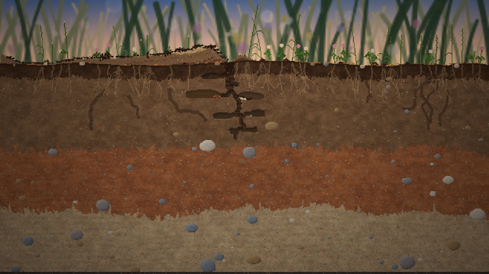
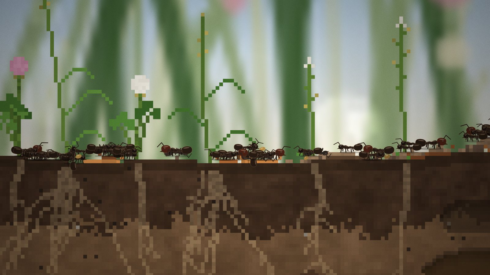
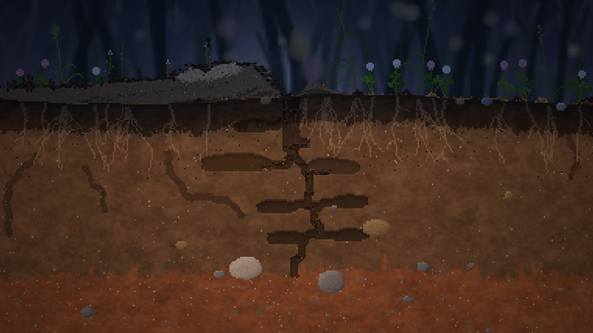

# Underfoot — Tasarım Belgesi

*Çalışma adı. Gece prototipi, 12 Ekim 2026.*

## 1. Tek cümlede

Gerçek ölçekte bir toprak kesitinde, bir *Messor structor* (hasatçı karınca) kraliçesinin kurduğu koloniyi izliyorsun. Karıncalara tek tek emir vermiyorsun, koloninin neyi önemsediğine karar veriyorsun.

## 2. Bu gece ne yapıldı

- **Oynanabilir link:** https://claude.ai/artifact/Ja2FVX7Gs5UHxjRM7yPXha (özel; yalnızca sen açabilirsin, istersen Share menüsünden paylaşırsın).
- Tarayıcıda oynanabilir prototip var: kraliçe iner, kanatlarını koparır, yuvasını kazar, ilk işçileri büyütür. Sonra koloni kendi başına büyür: kazar, tohum toplar, ambar doldurur, yavru besler, çöp atar. Yağmur ve fırtınada su basar, ıslak tavanlar çöker.
- Koloni beyni arayüzü (Mod B) çalışıyor.
- Simülasyon sağlam. 8 farklı haritada otomatik test:
  - 30 dakika (5 oyun günü): 145–200 işçi, 2400–3300 hücrelik yuva.
  - 60 dakika (10 oyun günü): 120–320 işçi, 3300–5800 hücre. Hepsi hayatta.
  - Ölümlerin neredeyse hepsi yaşlılıktan. Fakir haritalarda arada birkaç açlık ölümü oluyor; bu bilinçli bir baskı.
- Gece sonunda kodu iki ayrı gözden geçirmeden geçirdim; toplam 15 hata bulundu ve düzeltildi. Hepsi ölçülerek doğrulandı. En önemlileri:
  - Bir kez zaman aşımına uğrayan taşıyıcılar sonraki bütün yüklerini sessizce yok ediyordu; kazılan toprağın çoğu kayboluyordu.
  - Yüzeydeki bir su damlası hiç kurumuyor, yolu kesip toplayıcıları dışarıda mahsur bırakıyordu.
  - Ambar, tohumu kapısına yığıp kendini kapatıyordu.
  - Karıncaların kursağındaki yüzlerce tohum hesaba katılmıyordu; koloni açlık çekiyormuş gibi davranıyordu.
  - Bunlar düzelince koloniler belirgin şekilde daha sağlıklı büyüyor.
- Gecenin ikinci yarısında eklenenler: anatomik makro karıncalar, zengin toprak dokusu, *Messor* krateri, saha defteri, belgesel kamera, kazı planı ve koku izi görünümleri, evlilik uçuşu açılışı, otomatik kayıt, tohum türleri, çimlenen tohum, antenleşme.
- Gece boyunca bulunan ve düzeltilen önemli hatalar: krater kenarında sapı kesilip havada kalan bitkiler toplayıcıları kilitliyordu (iki haritada koloni açlıktan ölüyordu); kraliçe yüzeydeki bir çakılın üstüne inince kazamıyordu.
- Çalıştırmak için: `npm install` ve ardından `npm run dev`. Tek dosyalık sürüm için `npm run build:artifact`.

## 3. Görsel dil: seçtiğim yön ve nedenleri

Hedef şu: ekran görüntüsünün kendisi paylaşılmak istensin. Bir doğa belgeselinin makro çekimi ile bir laboratuvar gözlem düzeneğinin arasında bir yerde duruyoruz. Çizgi film karıncası yok.

### 3.1 Gerçek ölçek: 1 hücre = 1 mm

- Dünya 640 × 360 hücre, yani 64 × 36 cm'lik bir toprak dilimi. Bu, gerçek bir gözlem formikaryumu boyutu.
- Minör işçi 7 mm, majör 9 mm, kraliçe 13 mm boyunda; gerçek *Messor structor* ölçüleri.
- Tohum 1–2 hücre, kum tanesi 1 hücre.
- Karınca saniyede 15 mm yürür; bu, gerçek *Messor* hızı.

**Neden:** Formicarium dahil benzer oyunların çoğunda ölçek keyfi. Gerçek ölçek bize iki şey kazandırıyor:

1. Her şey "doğru" görünüyor. Yaprak, çakıl ve kök kendi gerçek boyutunda.
2. Ölçek pazarlamada kullanılabilir: "64 cm toprak, 150 karınca, hepsi gerçek boyutta."

### 3.2 Makro objektif hissi

Görüntü üç katmandan oluşuyor, bir makro fotoğraftaki gibi:

1. **Arka plan (odak dışı):** çayır, gökyüzü, bokeh. Yumuşak ve bulanık.
2. **Toprak kesiti (sahne):** keskin piksel sanatı, 1 piksel = 1 mm.
3. **Karıncalar (özne):** ekran çözünürlüğünde, her yakınlaştırmada keskin (bkz. 3.3).

Ayrıntılar:

- Toprak kesiti keskin piksel sanatı.
- Arkadaki çayır, gökyüzü ve çimen yarım çözünürlükte çiziliyor ve yumuşak büyütülüyor. Böylece arka plan, makro fotoğraftaki gibi alan derinliği dışında kalıyor.
- Arka planda bokeh daireleri ve gece ateş böcekleri var.
- Kenarlarda vinyet, üstünde hafif film greni var.

**Neden:** Piksel sanatı tek başına "retro oyun" diye okunuyor. Arkadaki bulanıklık ise "kameranın önündeki gerçek bir şey" diye okunuyor. İkisi birlikte hem okunaklı hem de sinematik duruyor. Bu, klip aracı fikriyle de doğrudan bağlantılı (bkz. 7.4).

### 3.3 Karıncalar: sahnenin öznesi

Karıncalar toprak gibi piksel olarak değil, ekran çözünürlüğünde çiziliyor. İlk denemede piksel karıncalar yakınlaştırınca okunmaz bir gürültüye dönüşüyordu. Makro lens fikrinde netlik özneye ait olmalı.

- **Anatomi:** *Messor*, Myrmicinae alt familyasından. Bu yüzden:
  - Belde iki boğum var (petiol ve postpetiol).
  - Göğsün arkasında küçük dikenler var.
  - Başın altında "psammofor" var: kum taşımaya yarayan sakal gibi kıllar. Bu kıllar yalnızca yakın planda görünüyor.
- **Hareket:**
  - Altı bacak tripod yürüyüşüyle adım atıyor.
  - Antenler sürekli tarıyor.
  - Karıncalar hücreden hücreye kaymadan süzülüyor.
  - Duvara ve tavana dönüp ters yürüyebiliyor.
  - Geri dönerken gövde gerçekten dönüyor.
  - Kazarken başını sallıyor.
- **Işık:**
  - Parlak kitin üstünde ince bir parlama var.
  - Kenarda bir piksellik sıcak bir ışık hattı var; üst üste binen karıncalar böylece ayrışıyor.
  - Yuvada arka duvara yumuşak bir gölge düşüyor.
- **Kastlar:** Majörün kafası iri ve kızıl-kahve. Kraliçenin karnı büyük; kanatları yarı saydam ve inince düşüyor.
- **Yavru ve ölüler:**
  - Larvalar beslendikçe şişiyor ve kursaklarında tohum lapası görünüyor.
  - Pupalar çıplak, çünkü Myrmicinae koza örmez. Olgunlaştıkça kararıyorlar.
  - Ölü karıncalar sırtüstü yatıyor, bacakları kıvrık.
- **Ambar:** Yakın planda tohumlar parlak taneler olarak yığılıyor, kabuklar soluk pullar gibi duruyor.
- **Ayrıntı seviyesi:**
  - Uzaktan sade bir siluet.
  - Yakında tam anatomi.
  - 150+ karıncada çizim maliyeti yaklaşık 2–3 ms.

**Neden:** Toprak piksel, karınca pürüzsüz. Bu bilerek yapılmış bir karışım. Sahne bir "tuval", karınca ise kameranın odaklandığı canlı. Yakın plan ekran görüntüleri ve klipler bu sayede belgesel gibi görünüyor. Bunu beğenmezsen karıncalar tekrar piksel yapılabilir; sorulardan biri bu (9. bölüm).

### 3.4 Toprak gerçek horizonlarla

- Yukarıdan aşağı katmanlar:
  1. Koyu humus ve kökler.
  2. Kahverengi tın.
  3. Paslı kırmızı kil (demir oksit).
  4. Soluk alt toprak ve çakıl.
- Her katmanın sertliği farklı. Kil en zor kazılanı ama tavanı en iyi o tutuyor.
- Tünelin arka duvarı, kazılan toprağın tonunu "hatırlıyor". Böylece kazılmış yer, kazılmamış yerden ayrı görünüyor.
- Toprak dokusu:
  - Çimenlerin saçak kökleri ve yoncanın kazık kökü, içinden geçtiği toprağın açık tonunda iplikler olarak görünüyor.
  - Eski solucan yolları (krotovina) koyu üst toprakla dolu. Gevşek oldukları için karıncalar bu yolları takip etmeyi sever.
  - Kilin içinde gri ve pas rengi lekeler var; suyun durduğu ve demirin paslandığı yerler.
  - Alt toprakta ince tabakalanma var.
  - Üst toprakta kömür parçacıkları var.
- Höyük gerçek bir *Messor* yuvası gibi alçak ve geniş: girişin yanında çayıra doğru incelen bir döküntü tepesi. Kazılan her tane gerçekten oraya taşınıyor, koloni büyüdükçe höyük de büyüyor.
- Yuva mimarisi kendiliğinden "Noel ağacı" şeklini alıyor: tek dikey şaft ve iki yanında yassı odalar. Bu, Tschinkel'in gerçek hasatçı karınca yuvalarına alüminyum dökerek çıkardığı kalıplarla aynı.

**Neden:** Toprak bu oyunun asıl tuvali. Katmanlar hem güzel görünüyor hem de oyuna anlam katıyor: derin kazmak pahalı ama güvenli.

### 3.5 Gece: kırmızı gözlem lambası

- Gece yer üstü maviye ve karanlığa döner.
- Yer altı ise kırmızı bir gözlem lambasıyla aydınlanır. Gerçek karınca bakıcıları da kırmızı ışık kullanır, çünkü karıncalar kırmızıyı göremez.
- Gün 6 dakika sürüyor (1x hızda). Şafak ve gün batımında gökyüzü renk geçişleri var.

**Neden:** Bu sayede gece de oynanabilir oluyor ve ekran görüntüleri günün saatine göre çok farklı renk kimlikleri kazanıyor. Akşam altın sarısı, gece kırmızı ve lacivert, yağmurda kurşuni.

### 3.6 Arayüz: laboratuvar aleti

- Yazı tipleri IBM Plex Mono (sayılar ve etiketler) ile IBM Plex Sans (metin).
- Koyu, yarı saydam ve bulanık arkalıklı paneller.
- Tek bir vurgu rengi var: kehribar (`#e2b45c`), tohum ve tahıl rengi.
- Arayüz bir saha defteri ya da gözlem cihazı gibi davranıyor. Sayılar ve grafik ön planda, süs yok.

**Neden:** Oyun "bilimsel gözlem" havasında. Arayüz sahneyle yarışmamalı, ona not düşmeli.

### 3.7 Palet

| Kullanım | Renk |
|---|---|
| Vurgu (tohum, seçili) | `#e2b45c` kehribar |
| Arayüz metni | `#efe6d6` kemik beyazı |
| Panel zemini | `#100c09` %74 opak |
| Kraliçe odası tonu | `#5a3350` mürdüm |
| Kreş tonu | `#7a6248` |
| Ambar tonu | `#7a5a26` |
| Dinlenme odası tonu | `#3e3328` |
| Uyarı | `#e07a5f` |

### 3.8 Bilerek yapmadıklarım

- Sevimli, gözlü, çizgi film karıncalar yapmadım. Karınca küçük ve gerçekçi; kişilik davranıştan gelmeli.
- Neon, bilim kurgu ve "oyunsu" HUD kullanmadım.
- Izgara ya da tile görünümü yok. Hücreler var ama toprak organik görünüyor.

## 4. Oyuncunun rolü: Koloni Beyni (Mod B)

Oyuncu tek bir karıncaya emir vermez. Koloninin önceliklerini belirler. Her işçi bu öncelikleri kendi yaşına, kastına ve gördüklerine göre tartar.

| Kontrol | Ne yapar |
|---|---|
| İş öncelikleri: Kazı / Toplama / Bakım / Temizlik (Kapalı · Düşük · Normal · Yüksek) | Koloninin o işe ayırmak istediği payı değiştirir. Altındaki çubuk ve yazı ("52 karınca · %25") gerçekte kaç karıncanın o işte olduğunu gösterir. Kazılacak plan yoksa "yuva yeterli" yazar. Açlığa kapalı bir iş yol açıyorsa uyarı o işin adını verir ve satırı yanıp söner. |
| Kraliçe: Üreme (Düşük · Normal · Yüksek) | Yumurta hızını belirler. Yüksek üreme hızlı büyütür ama yiyecek yetmezse açlık riski doğar. Altında yavru sayısı ve son bir saatteki eğilimi (▲ ▼) görünür. |
| Majör oranı | Yavruların ne kadarının iri kafalı majör olacağını belirler. Majörler iri ve yavaş. Gerçekte tohum kırarlar; bu davranış henüz simde yok (8. bölüm). Rakip koloni gelirse savaşta işe yarayacaklar. |
| Yuva: + Kreş / + Ambar / + Dinlenme odası / Daha derine kaz | Yer varsa oda hemen kazı planı olarak çizilir; yoksa sıraya girer (en çok 4, × ile iptal). Dilimin dibine inildiği için yeri kalmayan sipariş düşer ve günlüğe yazılır. "Daha derine kaz" bir seferde tek adımdır. |
| Büyüme işareti | Yeraltında bir noktaya tıklarsın, koloni o yöne doğru genişler. Gökyüzü, taş ve kenarlar kabul edilmez; işaret × ile silinir, Esc işaretlemeyi bırakır. |
| Sandbox: Yağmur / Fırtına | Hava zaten kendiliğinden geliyor. Bu butonlar yuva tasarımını hemen test etmek için var. |

Ayrıca:

- Bir karıncaya tıklarsan kamera onu takip eder. Karıncanın etrafında kehribar köşeli parantezler çıkar; panelde adı, kastı, yaşı, ne yaptığı ve ne taşıdığı görünür.
- H tuşu (ya da alttaki Gizle düğmesi) sinema modunu açar: paneller ve seçim köşeleri gizlenir, belgesel alt yazısı kalır.
- Takip edilen karınca ölünce kısa bir hayat kartı çıkar: kaç gün yaşadığı, kaç tohum getirdiği, neden öldüğü.
- Koloni beyni ilk işçiler çıkana kadar soluk durur. İnişten sonra oyun 4× hızda başlar; iniş ekranında simülasyon donuktur, böylece aynı harita aynı yerden başlar.
- Arayüz İngilizce ve Türkçe (dil tablosu `src/ui/i18n.ts`).
- Kayıt oyun zamanına bağlı: birkaç oyun saatinde bir, sekme gizlenince ve kapanırken.
- **Saha defteri:** Kartın altında zaman damgalı bir olay günlüğü tutuluyor. Örnekler: "D3 14:20 — Ambar bitti, 6.2 cm derinde", "Sel: 5 yavru boğuldu", "Koloni 100 işçiye ulaştı". Bildirimler kaybolup gidiyor, günlük kalıyor.
- **Belgesel kamera (Watch / C):** Kamera 10–16 saniyede bir özne seçip yavaşça takip ediyor. Özneler: tohum taşıyan toplayıcı, kazı yüzündeki işçi, yumurtlayan kraliçe, larva taşıyan bakıcı, ambarın yakın planı, yuvanın genel görüntüsü. Altta saha notu tarzında bir alt yazı çıkıyor: "Forager Ila-8 · bringing a seed home · 4.1 cm from the nest". Elle kamera hareketi kontrolü geri veriyor. "İzle" tarafının ilk adımı ve klip aracının (7.4) bir ön tadı.
- **Koku izleri (T):** Toplayıcıların bıraktığı feromon izleri turkuaz bir hale olarak görünüyor. Karıncaların neden aynı yolları kullandığı böylece okunuyor.
- **Açılış:** Oyuncu iniş yeri seçerken kanatlı kraliçe odak dışı çayırın üstünde uçuyor ve imlecin gösterdiği yerin üstünde süzülüyor. Tıklayınca oraya iniyor, bir an duruyor, sonra kanatlarını koparıyor.
- **Kayıt:** Koloni yaklaşık dakikada bir ve sekme kapanınca tarayıcıya kaydediliyor (sıkıştırılmış, ~0,5 MB). Tekrar açınca iniş ekranında "Continue colony · Day N · X workers" çıkıyor; saha defteri de geri geliyor. Steam sürümünde aynı kayıt dosyaya yazılacak.
- **Kazı planı (P):** Koloninin kazmayı planladığı toprak kehribar noktalarla görünüyor. Büyüme işareti bir nişangâh olarak çiziliyor. Bir oda sipariş edince ya da işaret koyunca birkaç saniye kendiliğinden görünüyor. Böylece oyuncu, koloni beyninin kararını görüyor.
- Bir odanın üstüne gelirsen derinliği, içindeki tohum ya da yavru sayısı ve kısa bir doğa notu çıkar ("Messor tohumu kuru tutar; ıslanırsa filizlenir ve dışarı atılır").
- Kısayollar: Boşluk duraklatır, 1–5 hız seçer, F tüm kesiti gösterir, tekerlek zoom yapar, sürükleme kaydırır. **?** tuşu (ya da alt çubuktaki ? düğmesi) bütün tuşları gösteriyor; oradan yeni koloni de başlatılabiliyor.

## 5. Simülasyon: şu an çalışan sistemler

**Dünya**

- Hücre tabanlı toprak: malzeme, ton, nem ve "arka duvar" katmanları.
- Gevşek malzeme (kazı toprağı, tohum, çöp) düşen kum fiziğiyle akıyor.
- Yerleşen toprak sıkışıp şev tutuyor.
- Su akıyor, toprağa emiliyor ve nem aşağı sızıyor.
- Su kök kanallarından ve eski solucan yollarından daha hızlı iniyor, kile ise zor giriyor (tercihli akış). Bu yüzden krotovina yakınına kazılan oda daha çabuk ıslanıyor.
- Doymuş tavan ve duvarlar çöküyor.

**Kraliçe ve kuruluş**

- Kraliçe kanatlarını koparıyor, A* ile bir giriş şaftı ve bir kraliçe odası kazıyor.
- Kapalı kuruluş (claustral) yapıyor: ilk yavruları kendi vücut rezerviyle besliyor, dışarı çıkmıyor.

**Yavru**

- Yumurta, larva ve pupa evreleri var. Larvalar beslenmeli; beslenmeyen ölür.
- Bakıcılar yavruyu kreşe taşıyor.
- Su basan kreşte yavru boğuluyor.

**Kastlar ve görev dağılımı**

- Minör ve majör işçi var.
- Görev, açık ilkesiyle dağıtılıyor: oyuncu önceliği ile koloni ihtiyacının çarpımı istenen payı verir, gerçekleşen payla karşılaştırılır.
- Yaşa bağlı iş bölümü var: genç işçi bakıcı, yaşlı işçi toplayıcı olur. Bu gerçek karıncalarda da böyle.
- Karıncalar yeni görevi sadece yuvadayken alır. Kaybolan karınca yükünü bırakır ve yeniden düşünür.
- Kafa kafaya karşılaşan iki karınca bir an durup antenleriyle dokunuşuyor. Ara sık değil, yoksa şaft tıkanırdı.

**Yuva planlayıcı**

- Koloni nüfusa göre yer ihtiyacı hesaplar.
- Sırayla ambar, kreş, dinlenme odası ekler ve şaftı derinleştirir.
- Odalar düz tabanlı, loblu "krep" şeklinde. Gerçek *Messor* odaları da böyle.
- Bağlantı yolu bulunamayan oda planlanmaz.
- Kopan işler yeniden bağlanır.
- Yuvaya düşen toprak "temizlenecek" olarak işaretlenir.

**Toplama**

- Toplayıcı bir yön seçip uzaklaşıyor, sonra arıyor.
- Yakındaki tohumu kokluyor, iz feromonu bırakıyor ve izi yönüyle takip ediyor.
- Ulaşılamayan bir kokuyu (sapı kesilmiş ya da toprak altında kalmış bir bitkinin tohumu) bir süre sonra bırakıyor. Yoksa bütün toplayıcılar oraya yığılırdı.
- Beş bitki türü var (brom otu, yonca, çoban çantası, sorguç otu, dönbaba) ve her birinin tohumu farklı görünüyor. Ambara bakınca hangi bitkilerin hasat edildiği anlaşılıyor.
- Tohumu ambara taşıyor. Ambar yoksa tohum ortak kursağa (trofalaksi) gidiyor.
- Toplama menzili uyarlanıyor: en son yiyeceğin bulunduğu mesafeyi izliyor, boş dönülen aramalarda büyüyor. Yuvanın çevresi tükenince koloni daha uzağa gidiyor.
- İz kesitin kenarından öteye devam ediyor: toplayıcı görüş dışına, ötedeki çayıra çıkıp mevsimine göre tohumla dönüyor (ve arada bir hiç dönmüyor).
- Yağmurdan sonra ıslanan ambar tohumu güneşe çıkarılıp kurutuluyor (Moggridge, 1873). Toplayıcılar kuruyunca geri topluyor.
- Böcek leşi ve yağmurla yüzeyde kalmış solucan protein: larvaya verilen bir parça iki öğün sayılıyor.

**Yiyecek döngüsü**

- Tohum yeniyor, kabuğu kalıyor. Temizlikçiler kabukları üçer üçer dışarıdaki çöp yığınına (midden) taşıyor.
- Ölüleri yuvadan çıkarıyorlar. Dışarıda kalan ölüleri leşçiler zamanla götürüyor.
- Islanan tohum ambarda çimleniyor ve artık yiyecek sayılmıyor. İşçiler filizleri dışarı atıyor. Bu gerçek bir *Messor* davranışı ve saha defterine düşüyor.
- Açlık başlarsa kraliçe yumurtayı kısıyor ve işçiler toplamaya kayıyor.

**Takvim ve hava**

- Gündüz–gece döngüsü gerçek hızında (1×'te bir gün 6 dakika); biyoloji haftalık takvimle işliyor: bir oyun günü bir hafta.
- Sıcaklık sahanın aylık ortalamalarından: yüzeyde günlük dalga, güneşte çıplak toprağın ısınması; derinlikte sönümlenen günlük ve mevsimlik dalga. Yavru gelişimi, toplama penceresi, yemek ve yaşlanma sıcaklığa bağlı.
- Kış uykusu: ortalama hava 6,5 °C'nin altına inince kapı tıkanıyor, koloni derin odalarda toplanıyor; kar yağıp yalıtıyor, eriyince toprağa siniyor. Kış hızlı geçiliyor.
- Yılda bir evlilik uçuşu: kanatlı kraliçe ve erkekler yazın yetişip ilkbaharda yağmurdan sonra sıcak bir sabah uçuyor.
- Yağmur sahanın aylık sıklığıyla geliyor; yazın bir kısmı fırtına ve şimşek.
- Yağmurda toplayıcılar eve koşuyor, yer üstündekiler sığınıyor.
- Suya düşen karınca havaya doğru yüzüyor ya da boğuluyor.

**Sahalar ve haritalar**

- Altı gerçek saha: Pannonya lösü (çernozyom), kumlu bozkır, kireçtaşı tepe (rendzina), bağ kenarı, Orta Anadolu (kireç katmanlı kastanozem), Karadeniz kuzeyi tüylü ot bozkırı. Her birinin iklimi, toprak profili, bitki karışımı ve kazıcı hayvanı ayrı.
- Aynı sahanın her haritası farklı: üst toprak kalınlığı, bakı (güney yamaç sıcak, kuzey serin), tohum bankası zenginliği, kil merceği, yassı taşlar, eski yuvalar, ağaç, çalı, dipte taban suyu, çömlek kırıkları, kemikler, ağustos böceği perileri. Saha kartında artı ve eksi olarak görünüyor.
- Dünya 128 × 72 cm; görünen alan yuva ve toplayıcıların menziliyle birlikte büyüyor.

**Yüzey ekolojisi**

- Bitkilerin tohum takvimi gerçek: dönbaba ve çoban çantası baharda, otlar yaz başında, yonca yaz sonunda tohum veriyor. Yaz sıcağında çayır sararıyor, tek yıllıklar ölüyor, çok yıllıklar kışın tutama çekilip baharda yeniden sürüyor. Kışlık tek yıllılar rozet olarak kışı geçirip baharın ilk tohumunu veriyor.
- Fideler yağmurdan sonraki haftada çıkıyor: yerdeki tohumdan, topraktaki tohum bankasından ve karıncaların çöp yığınına attığı filizli tohumlardan (karınca bahçesi). Sorguç otu ve dönbaba tohumları ıslanınca kılçıklarıyla kendilerini toprağa vidalıyor.
- Karaçalı ya da kuşburnu karınca boyundan görünüyor: gövdeler kadrajdan çıkıyor; baharda çiçek, iri yapraklar, sonbaharda yukarıdan düşen çakal erikleri ve kuşburnular. Ağaç yazın gölge yapıyor (öğlenler serin, baharda yavru yavaş) ve sonbaharda iri yapraklarını döküyor.
- Hayvanlar: tohum ve arada karınca gagalayan tepeli toygar (yakınındaki toplayıcılar eve kaçıyor), yaz çekirgeleri (sonbaharda ölüp protein oluyor), geceleri tohum yiyen Harpalus böcekleri, toprağın içinde dolaşan solucanlar.
- Kuşlar, fareler ve çürüme yerdeki fazla tohumu, meyveyi ve leşi zamanla götürüyor.
- Fareyle üzerine gelinen bitki, hayvan ve buluntu adını, durumunu ve kısa bir bilgiyi gösteriyor.

**Tehditler (araştırma raporundaki kayıtlara göre)**

- *Zodarion* örümceği: akşamdan itibaren toplayıcı izinin yanında pusuya yatıyor, tek ısırıkla felç edip sürüklüyor (genç örümceğin zehri ~1,5 kat geç etkiliyor). Etrafına birkaç işçi toplanırsa avını bırakıp kaçıyor.
- Forid sinek (*Razorfemora*): Mayıs–Temmuz arası gündüz yalnızca orta boy işçilere yumurta bırakıyor; en küçükler ve majörler güvende. Fark eden karınca "C" duruşuna geçiyor, yanındakiler donuyor ve sinek vazgeçiyor. Yumurta bırakılan işçi 1,5–2,5 hafta sonra içindeki larva yüzünden ölüyor.
- Mantar ve sosyal bağışıklık: sıcak, nemli haftalarda kazıcı ve toplayıcılara spor bulaşıyor; yuvadaşlar temizliyor (erken temizlenen iyileşiyor, temizleyen küçük doz alıp bağışıklık kazanıyor); ölmek üzere olan işçi yalnız ölmek için yuvadan uzaklaşıyor; yuvada kalan küflü ceset çevresine spor saçıyor.
- Kumlu sahalarda karınca aslanı çukurları; yakalayan larva haftalarca sindiriyor.
- Yuva misafirleri: kör beyaz tespihböcekleri (kavuz yiyor), yiyecek dilenen karınca cırcırı, Orta Avrupa sahalarında yalnızca *M. structor* yuvalarında bilinen *Attaephilus molitori*.

**Komşular ve kuruluş kaybı**

- Haritaların çoğunda kenarın ötesinde daha yaşlı bir komşu koloni var; yalnızca toplayıcıları kesite giriyor ve aynı tohumlar için yarışıyor (komşunun rengi okunabilirlik için hafif kızıl).
- Karşılaşmalar çoğunlukla ritüel boks: ön bacaklarla itişip biri geri çekiliyor. Yağmurdan sonraki ılık, nemli günlerde nadiren savaş çıkıyor; savaşın kokusu forid sinekleri çekiyor (Delgado, Disney & Palma 2020).
- Çok güçlü bir komşu zayıf koloninin ambarını yağmalayabiliyor; majörler depoya iniyor.
- Aynı uçuştan 2–4 genç kraliçe daha kesite iniyor. Kuşlar, komşunun işçileri ve (ilk işçilerden sonra) bizim toplayıcılar onları bulup öldürüyor; ilk kışta saha defteri kaçının hayatta kaldığını söylüyor.

**Anlatıcı katmanı**

- Kraliçe sahanın bölgesinden bir isim alıyor (Elif, Ilka, Oksana…); koloni yuvanın yanındaki belirgin şeyle anılıyor (Karaçalı kolonisi, Yassı taş kolonisi, Sorguç otu kolonisi…).
- Olayların konumu var: belgesel kamera kuşun konduğu, örümceğin ısırdığı, savaşın çıktığı yere kesiyor; saha defterindeki satırlar da oraya götürüyor.
- Mevsim dönerken başlık kartı; kış uykusu başlarken "yılın özeti" kartı (işçi, doğum, nedenleriyle kayıplar, depo, savaş ve yağmalar, uçuş).

**Performans**

- 300 karıncalık kolonide simülasyon adımı yaklaşık 0,45 ms (16× hızda bir çekirdeğin ~%20'si). Zamanın çoğu mesafe alanlarına ve kum fiziğine gidiyor.
- Altı sahada 8 haritalık bir yıllık testte (60 hafta) bütün koloniler kışı geçti; ikinci yılın Haziranında 30–85 işçi, 180–510 tohum stok.
- Görüntüsüz test aracı var: `npm run headless` ve `scripts/batch.sh`.

## 6. Formicarium'dan aldıklarımız ve geçtiğimiz yerler

**Aldıklarımız**

- Yan kesit toprak.
- Piksel toprak ve kazıların kalıcı izleri.
- "Kendi kendine yaşayan koloni" hissi.

**Geçtiğimiz yerler**

1. **Gerçek ölçek ve gerçek tür.** Davranışlar *Messor structor*'un gerçek biyolojisine dayanıyor: ambar, majörler, kuruluş, midden.
2. **Oyuncu rolü.** Formicarium bir oyuncak. Bizde koloni beyni katmanı var; kararların sonucu var.
3. **Hava ve su.** Yuva tasarımının bir sınavı var: su basıyor, tavan çöküyor.
4. **Görsel derinlik.** Makro lens arka planı, gün döngüsü ve kırmızı gece lambası var.
5. **Steam'e uygun yapı.** Sezon ve run yapısı, rakip koloni ve klip aracı planlanıyor (aşağıda).

## 7. Yol haritası: öneriler, kararı birlikte vereceğiz

Aşağıdakiler benim önerilerim. Senin "benle konuşmadan tasarımı komple yapma" isteğine uyarak bunların hiçbirine başlamadım. Gece sadece temel simülasyonu ve görsel dili kurdum.

### 7.1 Rakip koloni

**Öneri:** Aynı kesitte, karşı tarafta ikinci bir koloni olsun. Bu, *Messor* ya da daha agresif bir tür olabilir; örneğin *Tetramorium* (kaldırım karıncası). Gerçekte de *Tetramorium* ile *Messor* arasında toprak savaşları olur.

Çatışma tohum alanı üzerinden çıkar:

- Toplayıcılar karşılaşınca kavga eder.
- Majör oranı burada anlam kazanır.
- Kazı sırasında tüneller birleşirse yeraltı savaşı başlar.

**Seçenekler:**

- (a) Rakip tamamen yapay zekâ.
- (b) Rakip ikinci bir oyuncu (aynı ekran ya da asenkron).
- (c) Rakip yalnızca belirli run'larda gelen bir tehdit.

### 7.2 Sezon / run yapısı

**Öneri:** Bir run bir koloninin ömrü olsun. İlkbaharda kurulur ve kışa kadar sürer, yaklaşık 60–90 dakikalık bir oturum.

- Kışa yeterli ambar ve yeterli derinlik (don sınırının altı) ile girersen koloni hayatta kalır.
- Hayatta kalan koloni bir sonraki sezonda kanatlı kraliçe ve erkek çıkarır. Bu "skor" olur ve bir sonraki run'a taşınan kazanım (meta ilerleme) verir: yeni tür, yeni harita, yeni özellik.
- Sezonun dinamikleri:
  - Yaz: kuraklık, tohum bol.
  - Sonbahar: yağmur ve sel.
  - Kış: toprak donar, koloni derinde uyur.

**Açık soru:** Roguelite mı (her run sıfırdan, meta ilerleme var), yoksa uzun soluklu tek koloni mi (Dwarf Fortress gibi)?

### 7.3 Türler

**Öneri:** Her tür farklı bir oyun stili olsun.

| Tür | Oyun stili |
|---|---|
| *Messor structor* (hasatçı) | Ambar ekonomisi, majörler, sabırlı. Başlangıç türü. |
| *Lasius niger* (bahçe karıncası) | Yaprak biti çiftliği (ballı özsu), hızlı büyüme, küçük işçi. |
| *Camponotus* (marangoz) | Toprak yerine çürük ahşap kazar, gece aktif, iri. |
| *Tetramorium* | Agresif, kalabalık, savaş odaklı. Rakip olarak da kullanılabilir. |
| *Solenopsis* (ateş karıncası) | Sel olunca sal kurar! Hava sistemimizle çok iyi eşleşir. |

### 7.4 Dahili klip aracı

**Öneri:** Oyun son 60 saniyeyi sürekli bellekte tutsun. Bir tuşa basınca:

- 15 saniyelik bir klip kaydedilir.
- Kamera sinematik bir yörünge, zoom ve odak çeker.
- Dikey (9:16) ve yatay format seçilebilir.
- Üstüne "Gün 4 · 87 işçi · *Messor structor*" gibi saha notu yazısı eklenir.

**Neden:** Bu tür oyunlar TikTok ve Instagram'da büyüyor (fieldnotes.sim örneği). Oyuncunun kendi kolonisinin videosunu tek tuşla paylaşması bedava pazarlama. Makro lens görsel dili bunun için seçildi.

**Teknik:** Canvas'tan `MediaRecorder` ile WebM, Electron'da da MP4'e çevirme.

### 7.5 Steam / Electron

- Şu anki yapı TypeScript, Vite ve Canvas2D. Bağımlılığı yok, tek dosyaya derleniyor.
- Electron sarmalı ile Steam'e çıkış kolay. Vampire Survivors da web teknolojisiyle yapılıp Steam'de çıktı.
- Steamworks entegrasyonu `steamworks.js` ile olur (başarımlar, bulut kayıt).
- Kayıt sistemi var: genel bir nesne grafiği serileştiricisi (sınıf örnekleri, paylaşılan referanslar, typed array'ler ikili olarak). Steam'de localStorage yerine dosyaya yazmak tek satırlık bir değişiklik.

## 8. Bilinen sorunlar

- **Tek giriş, yoğun trafik.** Büyük kolonide 60'tan fazla karınca aynı şafttan geçiyor: toprak taşıyanlar, kabuk atanlar, toplayıcılar. Gerçekçi ama görsel olarak kalabalık.
  - Önerim: koloni 120 işçiyi geçince ikinci bir giriş açılsın (gerçek büyük *Messor* yuvalarında birden çok giriş olur).
  - Bu bir mimari kararı olduğu için sormadan yapmadım.
- Yağmur suyu kök ve solucan yollarından iniyor ama sağlam toprakta yine sığ kalıyor; tavan çökmeleri hâlâ nadir. Sel asıl olarak yuva ağzından giriyor.
- **Majörler tohum kırmıyor.** Gerçek *Messor*'da majörler tohumu kırıp "karınca ekmeği" yaparlar. Şu an tüketim soyut: tohum ambardan eksiliyor, kabuk kalıyor. Görünür bir "değirmen" davranışı yiyecek akışını değiştireceği için ayrı ele alınmalı.
- **Ambarlar küçük kalıyor.** Kraliçe fazla yiyeceği hemen yavruya çeviriyor. Bu bilinçli: oyuncu üremeyi Düşük'e alınca ambar doluyor. Yani büyüme mi, stok mu kararı oyuncuda.
- Ses yok.
- Klavye dışında erişilebilirlik ayarı yok.

## 9. Sana sorular: karar bekleyenler

1. **İsim.** "Underfoot" çalışma adı. Türkçe bir isim mi istersin, İngilizce mi? Steam için İngilizce daha geniş kitleye ulaşır.
2. **Run yapısı.** Roguelite sezonlar mı (7.2), yoksa uzun soluklu tek koloni mi?
3. **Rakip koloni.** Yapay zekâ mı, ikinci oyuncu mu, sadece tehdit mi (7.1)?
4. **İlk eklenecek ikinci tür hangisi?** Benim önerim *Solenopsis* (sal kurma) ya da *Lasius* (yaprak biti çiftliği).
5. **Görsel dil.** Makro lens + gerçek ölçek + laboratuvar arayüzü yönü sana uyuyor mu? Değiştirmek istediğin bir şey var mı?
   - Özellikle: toprak piksel, karıncalar pürüzsüz (3.3). Bu karışımı beğendin mi, yoksa her şey piksel mi olsun?
6. **Oyuncu müdahalesi.** Koloni beyni dışında doğrudan dünya müdahalesi (tohum bırakma, su dökme, taş koyma) olsun mu? Şu an yalnızca sandbox'ta yağmur var.
7. **Ses.** Ambiyans tasarımı ne yönde olsun? Mikrofonla kaydedilmiş gerçek toprak sesleri, ya da minimal synth?
8. **İkinci giriş.** Büyük kolonilerde ikinci bir giriş açılsın mı (8. bölüm)? Oyuncu bunu kendisi mi işaretlesin, yoksa koloni kendisi mi karar versin?
9. **Majörlerin görevi.** Şu an Majör kaydırıcısının somut bir faydası yok; majörler sadece iri ve yavaş işçiler. İki yol var:
   - (a) Değirmenci olsunlar: tohumu kırıp "karınca ekmeği" yapsınlar, böylece aynı tohumdan daha çok besin çıksın.
   - (b) Asker olsunlar: rakip koloni (7.1) gelince savaşsınlar.
   - Ya da ikisi birden. Hangisi?
